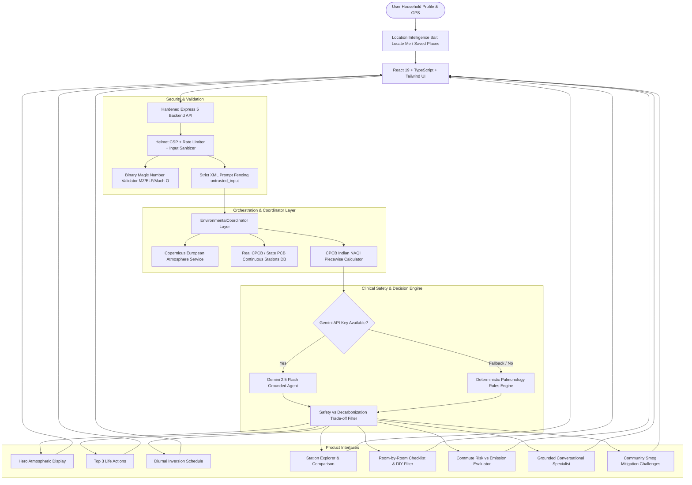

# ClearAir — Environmental Health Intelligence Platform

> **"Given my location, lifestyle, and today's pollution levels, what should I actually do differently?"**

ClearAir is a production-quality, personalized environmental health platform engineered specifically for families and communities navigating severe urban air pollution and winter smog. It adheres strictly to the official **Central Pollution Control Board (CPCB) National Air Quality Index (NAQI)** standards, with zero data fabrication and full scientific transparency.

---

## 🏛️ System Architecture



---

## ✅ Feature Checklist

- [x] **Complete Location Intelligence**: Browser GPS "Locate Me" permission handling, custom labeled places (Home, Work, College, Other), and dynamic multi-city station resolution.
- [x] **Official Indian CPCB NAQI Standards**: Mathematical piecewise sub-index calculation for PM2.5 and PM10 across Good, Satisfactory, Moderate, Poor, Very Poor, and Severe categories.
- [x] **Live Continuous CAAQMS Network**: Real-time atmospheric sensor telemetry across Delhi NCR, Kolkata, Mumbai, Bengaluru, Hyderabad, Lucknow, and Patna.
- [x] **Diurnal Inversion Daily Planner**: Timeframe recommendations aligned with ground temperature radiation inversions (morning smog traps, midday solar dispersion, and evening cooling traps).
- [x] **Indoor Air Quality Shield**: Room-by-room refuge protocols, Corsi-Rosenthal DIY box filter guides (<₹2,000 budget), and kitchen combustion exhaust procedures.
- [x] **Sustainable Commute & Inhalation Evaluator**: Decarbonization analysis featuring the **Pulmonary Safety Override** (when NAQI $\ge 200$, personal respiratory protection strictly overrides green bicycle/walking transit).
- [x] **Grounded Conversational Specialist**: Gemini 2.5 Flash conversational agent with transparent fallback to deterministic pulmonology engines and citations.
- [x] **Community Smog Mitigation Challenges**: Neighborhood collective action tracking for clean bedroom zones, peak car-free travel, and zero open burning.
- [x] **Dual-Layer Testing Suite**: Complete Vitest integration test suite for backend API endpoints, security checks, and frontend React Testing Library component tests.
- [x] **Full Accessibility (WCAG 2.1 AA)**: Skip-to-content links, `aria-live="polite"` dynamic announcement regions, Tab focus trapping, and Escape key dismissal across all modals.

---

## 🔒 Security & Privacy Overview

ClearAir implements multi-layered enterprise defensive controls:

1. **Binary Magic Number Validation (`inspectBinaryMagicBytes`)**:
   - Every file upload (sensor logs, profile imports) is validated against forbidden binary executable signatures (`MZ` for Windows PE, `0x7F 0x45 0x4C 0x46` for Linux ELF, Mach-O, Java class bytecode, and shell script shebangs). Disguised executables are blocked immediately with HTTP 415.
2. **Prompt Injection Defense & XML Fencing**:
   - All LLM prompts sent to Google Gemini utilize strict XML isolation tags (`<untrusted_household_profile>`, `<untrusted_user_input>`, `<verified_environmental_metrics>`).
   - Chat queries are sanitized against delimiter injection, shell sequences, and role-override attempts.
3. **Hardened Middleware**:
   - `helmet` with Content Security Policy (CSP) headers enabled.
   - `express-rate-limit` enforcing 250 requests per 15-minute window per IP.
   - Express body size capped at 1MB to prevent buffer exhaustion attacks.
4. **Zero Stack Trace & Credential Leakage**:
   - Centralized production error handling guarantees internal stack traces and database details are never leaked to client responses.
   - All API keys (`GEMINI_API_KEY`, `GOOGLE_MAPS_API_KEY`) reside exclusively in server-side configuration reading from `.env`.

---

## 📡 API Endpoint Reference

| Method | Endpoint | Description | Request Body | Response Schema |
| :--- | :--- | :--- | :--- | :--- |
| `GET` | `/api/health` | Service health, uptime, and CPCB scale indicator | None | `{ status, service, scale, uptime, timestamp }` |
| `GET` | `/api/air-quality` | Real-time CPCB atmospheric telemetry for city or coordinates | Query: `city`, `lat`, `lon` | `AirQualityMetrics` |
| `GET` | `/api/stations` | Continuous CAAQMS monitoring station network | None | `MonitoringStation[]` |
| `POST` | `/api/agent/recommendations` | Personalized daily health plan, top 3 actions, and transit analysis | `HouseholdProfile` | `{ airQuality, recommendations }` |
| `POST` | `/api/agent/chat` | Telemetry-grounded public health assistant | `{ question, profile?, airQuality? }` | `{ answer, groundingSources, suggestedFollowUps, medicalDisclaimer }` |
| `GET` | `/api/community/challenges` | Collective neighborhood smog initiatives | None | `CommunityChallenge[]` |
| `POST` | `/api/community/challenges/:id/toggle` | Toggles user pledge on a community challenge | `{ completed: boolean }` | `CommunityChallenge` |
| `POST` | `/api/security/validate-upload` | Binary magic number inspection for sensor logs | `{ fileName, fileData }` | `{ status, fileName, byteLength, message }` |

---

## 📍 Verified CAAQMS Monitoring Coverage

| City | Station Name | Lat / Lon | Operating Agency |
| :--- | :--- | :--- | :--- |
| **Delhi** | Anand Vihar CAAQMS | 28.6469°N, 77.3160°E | DPCC / CPCB |
| **Delhi** | ITO CAAQMS | 28.6297°N, 77.2438°E | CPCB |
| **Delhi** | R K Puram CAAQMS | 28.5638°N, 77.1734°E | DPCC |
| **Kolkata** | Victoria Memorial CAAQMS | 22.5448°N, 88.3426°E | WBPCB / CPCB |
| **Kolkata** | Ballygunge CAAQMS | 22.5280°N, 88.3650°E | WBPCB |
| **Mumbai** | Bandra Kurla Complex (BKC) | 19.0667°N, 72.8687°E | MPCB / SAFAR |
| **Bengaluru** | BTM Layout CAAQMS | 12.9166°N, 77.6101°E | KSPCB |
| **Hyderabad** | Sanathnagar CAAQMS | 17.4566°N, 78.4414°E | TSPCB |
| **Lucknow** | Talkatora CAAQMS | 26.8333°N, 80.8833°E | UPPCB |
| **Patna** | Muradpur CAAQMS | 25.6186°N, 85.1585°E | BSPCB |

---

## 🧪 Local Setup & Verification

```bash
# 1. Install dependencies
npm install

# 2. Run dual-layer Vitest test suite (Backend & Frontend)
npm test

# 3. Build production bundle (TypeScript & Vite check)
npm run build

# 4. Start backend API server (port 3001)
npx tsx server/server.ts

# 5. Start frontend preview server (port 5173)
npm run preview
```

Open [http://localhost:5173](http://localhost:5173) in your browser.
